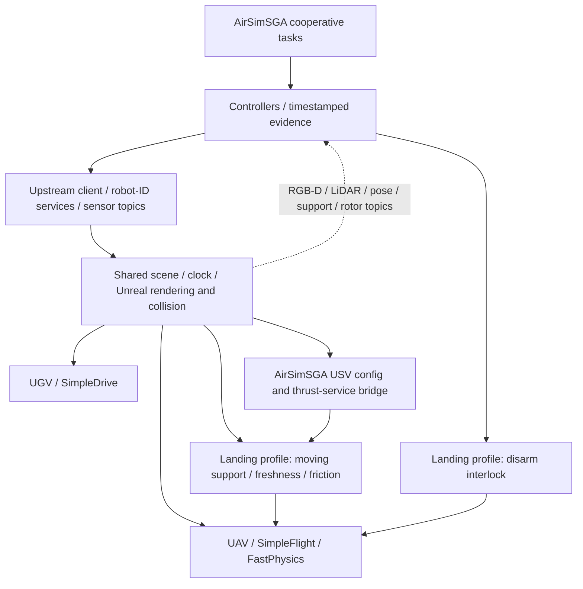

# Runtime architecture

The native namespace remains `microsoft::projectairsim`. Overlays/diffs show the
extension boundary; `airsimsga` is the public research entry, not a replacement
engine namespace. NED metres/wxyz quaternions are used. City Sample lane cm/z-up
coordinates are converted before planning. Sensor exposure poses/timestamps
remain independent from state RPC timing.

The landing USV path maps summed forces to forward speed and integrates once
per simulation tick at fixed water height. Deck support is a reduced-order
near-level contact model, not coupled ship/wave/gear hydrodynamics. Simulation
truth is used for ego alignment, scripted target motion, coarse landing approach
and evaluation as described in task code; it is not an unobserved visual detection.
